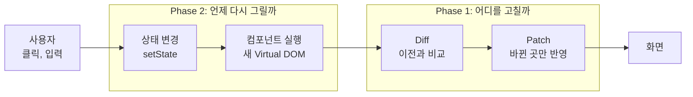
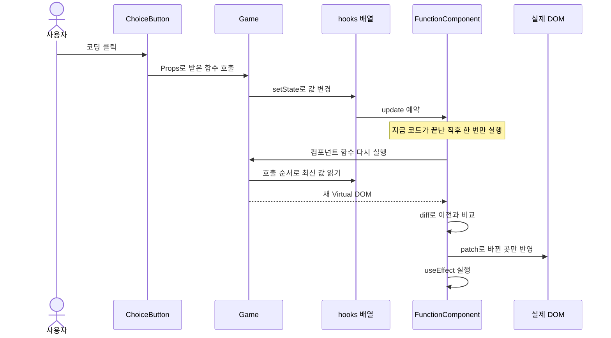

# tiny-react

**React 없이, React가 화면을 바꾸는 원리를 Vanilla JavaScript로 직접 구현**

- 버튼 클릭 시 화면 전체가 아닌 바뀐 곳만 수정
- 그 과정을 눈으로 확인하는 게임 `정글 생존기` 포함


## 1. 전체 그림

- 문제: 화면 전체를 다시 만들면 바뀌지 않은 요소까지 새로 생성 → Reflow, Repaint 증가, 입력 포커스 손실
- 해결: 화면의 설계도(Virtual DOM) 비교 → 달라진 곳만 수정



## 2. Phase 1: 바뀐 곳만 찾아서 수정

- HTML → `{ type, props, children }` 객체로 변환
- 이전 객체와 비교 → 변경 목록 생성
- 실제 DOM 수정은 `patch`만 담당


- 예시: `사과` → `포도`, 제목 → `오늘의 장보기` 수정 후 Patch
- 결과: 변경 두 건만 실제 영역에 반영

| 변경 | 예시 | 실제 DOM 작업 |
|---|---|---|
| `ADD` | `<li>` 증가 | `appendChild` |
| `REMOVE` | `<li>` 감소 | `remove` |
| `TEXT` | `사과` → `포도` | `nodeValue` 변경 |
| `REPLACE` | `<p>` → `<h3>` | `replaceWith` |
| `PROPS` | `class` 변경 | `setProp`, `removeProp` |

## 3. Phase 2: 상태 변경 시 자동으로 다시 그리기

> 함수는 매번 새로 실행되는데, 상태는 어떻게 유지할까?

**답: 상태를 함수 밖에 두고, 호출 순서로 탐색**

```text
FunctionComponent 인스턴스 (함수가 끝나도 유지)

hooks     [ 0: "정글러" ]  [ 1: 게임 진행 ]  [ 2: 남은 시간 17 ]  ...
               ▲                ▲                  ▲
Game() 실행    │                │                  │
           첫 번째           두 번째            세 번째
           useState          useState           useState
```

- 렌더 시작 시 번호 0으로 초기화, Hook 호출마다 1씩 증가
- 호출 순서가 바뀌면 칸이 어긋남 → Hook은 루트 컴포넌트에서만 사용
- 자식은 Props만 받는 순수 함수, 상태 변경은 Props로 받은 함수 호출 (Lifting State Up)

**버튼 한 번의 흐름**



| Hook | 칸에 저장 | 실행 시점 | 게임에서의 쓰임 |
|---|---|---|---|
| `useState` | 값 | 렌더 중 | 이름, 게임 진행, 남은 시간 |
| `useEffect` | deps, cleanup | `patch` 뒤 | 타이머, 기록 저장, 입력창 포커스 |
| `useMemo` | deps, 계산 결과 | 렌더 중 | 칭호, 글자별 판정 |

- Batching: `setState` 여러 번 호출 시에도 `update()`는 `queueMicrotask`로 한 번만 예약

## 4. 시연: 정글 생존기

- 정글에서 5일 버티고 프로젝트 발표까지 가는 게임
- 하루 세 번, 20초 안에 `코딩`, `담배 타임`, `코치님 몰래 나가기`, `집 가기` 중 선택
- 5일째 밤 발표: 개념 설명을 보고 40초 안에 함수 이름 입력


**관찰 패널: 엔진 내부를 그대로 표시하는 차별점**

1. 패널 열기 → `hooks` 0번 칸에 입력한 이름 확인 (상태가 함수 밖에 있다는 증거)
2. 대기 → 1초마다 `텍스트 "남은 시간 18초"로 변경` 한 줄만 기록 (숫자 하나만 변경)
3. `코딩` 클릭 → 스탯 숫자와 사건 기록만 변경
4. 발표에서 함수 이름 입력 → 글자마다 렌더, 입력 포커스 유지

## 5. 결과

- **테스트:** 단위 테스트 730개, Chrome 기능 테스트 53개 통과
- **검증:** 구현 담당과 검증 담당 분리, 검증 담당에는 구현 과정 비공개 → 렌더 재진입, 실패 뒤 재시도 무시 같은 버그 발견
- **AI 활용:** Phase 1 사용량 측정 후 설정 수정 → 쉬운 단위는 낮은 모델, 최종 리뷰만 최강 모델 → 구현·검증 1회 평균 비용 약 60% 감소

<details>
<summary>실제 React와의 차이</summary>

| 주제 | tiny-react | 실제 React |
|---|---|---|
| 상태 위치 | 루트의 `hooks` 배열 하나 | 컴포넌트마다 Fiber 노드 |
| 자식 컴포넌트 | 바로 실행, 태그만 남음 | 컴포넌트 경계 유지 |
| 렌더링 | 한 번에 완료 | 나누어 실행, 우선순위 조절 |
| 목록 비교 | 위치로만 비교 | `key`로 항목 구분 |
| `useEffect` | `patch` 직후 실행 | 보통 화면을 그린 뒤 실행 |
| 이벤트 | `element.onclick` 프로퍼티 | 루트에서 이벤트 위임 |

- 전체 차이: [요구사항 문서](docs/requirements.md#6-미니-리액트와-실제-react의-차이)

</details>

<details>
<summary>실행 방법</summary>

- Node.js 22에서 확인
- 기능 테스트는 설치된 Chrome 사용

```bash
npm install
```

```bash
npm run dev
```

- 개발 서버 실행 후 `http://localhost:5173` 접속
- 맨 위 링크로 Phase 1, Phase 2 페이지 이동

```bash
npm test
```

```bash
npm run test:e2e
```

</details>

<details>
<summary>파일 구조</summary>

```text
index.html                 Phase 1 검증 페이지
phase2.html                Phase 2 게임 페이지
src/
├── nav.css                두 페이지의 이동 링크
├── core/                  페이지와 무관한 엔진 코드
│   ├── domToVdom.js       DOM → Virtual DOM
│   ├── createDom.js       Virtual DOM → DOM, 속성 추가와 삭제
│   ├── html.js            Virtual DOM ↔ HTML 문자열
│   ├── diff.js            두 Virtual DOM 비교
│   ├── patch.js           변경 목록을 실제 DOM에 적용
│   ├── describeChanges.js 변경 목록을 한 줄 설명으로 변환
│   ├── h.js               Virtual DOM 생성, 자식과 속성 정리
│   ├── hooks.js           useState, useEffect, useMemo
│   └── FunctionComponent.js  hooks 배열, mount(), update()
├── phase1/                Phase 1 페이지 전용 코드
│   ├── StateHistory.js
│   ├── formatHtml.js      textarea용 HTML 정렬
│   ├── main.js
│   └── style.css
└── phase2/                Phase 2 페이지 전용 코드
    ├── gameData.js        선택지, 발표 문제 등 상수
    ├── gameLogic.js       게임 규칙 순수 함수
    ├── components.js      Props만 받는 자식 컴포넌트
    ├── Game.js            루트 컴포넌트, Hook 사용 위치
    ├── inspector.js       관찰 패널
    ├── main.js
    └── style.css
tests/
├── core/, phase1/, phase2/  단위 테스트
└── e2e/                   기능 테스트
```

</details>

<details>
<summary>문서와 알려진 한계</summary>

- [요구사항](docs/requirements.md)
- [Phase 1 설계](docs/architecture-phase1.md)
- [Phase 2 설계](docs/architecture-phase2.md)
- [디자인](DESIGN.md)
- [API](docs/api.md): JSDoc 자동 생성, `npm run docs`로 갱신

- `key` 미지원: 목록 앞쪽에 항목 추가 시 뒤따르는 항목 전체가 변경으로 기록
- Phase 1 입력 HTML 보안 필터링 없음: `<script>`도 그대로 실행되므로 신뢰할 수 없는 HTML 입력 금지
- `onChange`는 브라우저의 `change` 이벤트: 입력마다 받으려면 `onInput` 사용
- 나머지 한계: [Phase 1의 `범위 밖`](docs/architecture-phase1.md#범위-밖), [`Phase 2 범위 밖`](docs/architecture-phase2.md#phase-2-범위-밖)

</details>
