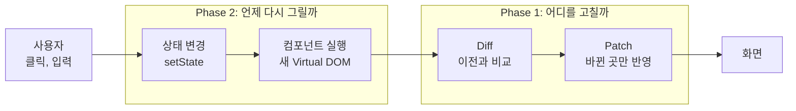

# tiny-react

**React 없이, React가 화면을 바꾸는 원리를 Vanilla JavaScript로 직접 구현**

- 발표용 README(게임 시연, 결과, 파일 구조): [docs/presentation.md](docs/presentation.md)

## 1. 우리가 구현한 React


| 구성 요소 | 하는 일 | 위치 |
|---|---|---|
| Virtual DOM | 화면을 `{ type, props, children }` 객체로 표현, 글자는 문자열 | `src/core/h.js` |
| Diff | 이전과 새 Virtual DOM을 비교해 변경 목록 생성 | `src/core/diff.js` |
| Patch | 변경 목록만 실제 DOM에 반영 | `src/core/patch.js` |
| FunctionComponent | `hooks` 배열, `mount()`, `update()` | `src/core/FunctionComponent.js` |
| Hooks | `useState`, `useEffect`, `useMemo` | `src/core/hooks.js` |
| Batching | `setState` 여러 번 호출 시에도 렌더는 한 번 | `queueMicrotask` |



- 상태 위치: 함수 밖, `FunctionComponent` 인스턴스의 `hooks` 배열
- 칸 찾기: Hook은 이름 대신 호출 순서로 자기 칸 탐색, 렌더 시작 시 번호 0으로 초기화
- 렌더링 순서: 컴포넌트 실행 → 새 Virtual DOM → Diff → Patch → effect 실행

## 2. 실제 React와의 차이

| 주제 | tiny-react | 실제 React |
|---|---|---|
| **목록 비교** | **위치로만 비교** | **`key`로 항목 구분** |
| **상태 위치** | **루트의 `hooks` 배열 하나** | **컴포넌트마다 Fiber 노드** |
| 자식 컴포넌트 | 바로 실행, 태그만 남음 | 컴포넌트 경계 유지 |
| 렌더링 | 한 번에 완료 | 나누어 실행, 우선순위 조절 |
| `useEffect` | `patch` 직후 실행 | 보통 화면을 그린 뒤 실행 |
| 이벤트 | `element.onclick` 프로퍼티 | 루트에서 이벤트 위임 |
| `onChange` | 브라우저 `change` 이벤트(입력이 끝날 때) | 입력할 때마다 |

- 굵게 표시한 두 가지를 3절에서 자세히 설명

## 3. 세부적인 차이

### 3.1 key 유무

- `key`: 목록 항목을 "몇 번째인가"가 아니라 "누구인가"로 비교하게 하는 이름표
- tiny-react: `key` 없음 → 같은 번호의 자식끼리 비교

**예시: `['사과', '우유', '빵']`에서 `사과` 삭제**

| 번호 | 이전 | 새것 | key 없음 (tiny-react) | key 있음 (React) |
|---|---|---|---|---|
| 0 | 사과 | 우유 | `TEXT` 우유로 변경 | 그대로 (`우유` 노드 유지) |
| 1 | 우유 | 빵 | `TEXT` 빵으로 변경 | 그대로 (`빵` 노드 유지) |
| 2 | 빵 | 없음 | `REMOVE` | `사과` 노드만 `REMOVE` |
| | | | **변경 3건** | **변경 1건** |

- 끝에서 추가, 삭제: 차이 없음
- 앞이나 가운데에서 추가, 삭제: 그 위치부터 끝까지 전부 변경

**문제 1: DOM 상태가 엉뚱한 항목으로 넘어감**

- DOM 노드에는 Virtual DOM에 없는 상태가 붙어 있음: 체크 여부, 입력 중인 글자, 포커스, 스크롤 위치
- key 없음 → 노드를 재사용해 글자만 변경 → 상태는 다른 항목에 남음

```text
사과에 체크한 뒤 사과 삭제

이전 DOM          새 화면
[✓] 사과   ──▶   [✓] 우유    ← 같은 노드를 재사용해서 체크가 우유로 넘어감
[ ] 우유   ──▶   [ ] 빵
[ ] 빵     ──▶   (삭제)
```

- 실제 발생 사례: 게임에서 밤에 키보드로 `코딩` 선택 → 회식 버튼 등장 → 포커스가 같은 노드인 `회식 참석`에 남음 → Enter 한 번에 회식 참석 (4절에서 회피)

**문제 2: 성능**

- Chrome에서 측정, 항목마다 체크박스, 글자, 버튼이 있는 `<li>` 하나 삭제
- 기준: 한 화면 약 16.7ms(1초에 60번), 넘으면 화면 끊김

| 항목 수 | 삭제 위치 | key 없음 | key 있음 (근사) |
|---|---|---|---|
| 100 | 맨 앞 | 1.1ms | 0.2ms |
| 1,000 | 맨 앞 | 7.9ms | 1.6ms |
| 5,000 | 맨 앞 | **41.8ms** | 5.1ms |
| 5,000 | 맨 끝 | 4.5ms | 6.0ms |

- 1,000개까지는 체감 차이 없음, 5,000개 맨 앞 삭제부터 끊김 가능
- key 쪽은 근사값: tiny-react에 key 비교가 없어 "전체 비교 + 노드 하나 삭제" 시간으로 대신 측정

### 3.2 컴포넌트별 State 없음

- tiny-react: `hooks` 배열이 루트 `FunctionComponent`에 하나뿐, 자식 컴포넌트는 State를 가질 수 없음 (과제 제약)
- 실제 React: 컴포넌트마다 자기 State 보유

**이유: 호출 순서로 칸을 찾는 구조**

- 자식이 Hook을 쓰면 자식의 칸도 같은 배열에 들어감
- 목록 항목처럼 개수가 바뀌는 자식 → Hook 호출 수 변화 → 칸이 어긋남

```text
items = ['사과', '빵'], 각 Item이 useState(done) 사용

첫 렌더    hooks: [items] [사과의 done=true] [빵의 done=false]
사과 삭제  hooks: [items] [빵이 1번 칸을 읽음 → done=true]   ← 빵이 완료로 보임
```

**결과**

| 항목 | tiny-react | 실제 React |
|---|---|---|
| 상태를 두는 곳 | 모든 상태를 루트로 올림 (Lifting State Up) | 쓰는 컴포넌트 가까이 |
| 상태 하나가 바뀌면 다시 실행되는 범위 | 루트 컴포넌트 전체, 화면 전체 Diff | 바뀐 컴포넌트와 그 아래만 |
| 자식에서 Hook 호출 | 오류로 차단 | 허용 |

- 화면이 커질수록 작은 상태 변경에도 전체를 다시 계산
- 예: 게임의 1초 타이머 → 매초 `Game` 전체 실행과 화면 전체 Diff, 실제 변경은 숫자 하나

## 4. 차이에 대한 수정 혹은 회피 방안

### 4.1 key 유무

**회피 (현재 적용)**

| 방법 | 적용한 곳 |
|---|---|
| 목록은 끝에만 추가 | 게임의 사건 기록: 최신순으로 뒤집지 않고 자동 스크롤 |
| 다른 항목이 같은 자리에 오면 감싸는 태그를 다르게 | 선택지 `div.choices`, 회식 버튼 `section.choices` → `REPLACE`로 새 노드 생성, 포커스 넘어감 차단 |
| 입력창은 바뀌는 목록 밖에 배치 | 발표 화면: 글자 칸과 입력창을 형제로 분리 |

**수정 (구현한다면)**

1. `diff`: 이전 자식을 `key`로 찾는 표 생성, 짝이 맞는 노드끼리 비교
2. 변경 종류 추가: "N번째 앞에 넣기", "이동"
3. `patch`: 지금은 번호(`path`)로 노드 탐색 → 중간 삽입, 삭제 시 번호가 밀림 → 적용 순서 재설계 또는 노드를 번호 대신 참조로 탐색

- 범위: `diff`, `patch`, 변경 형식 모두 수정 → Phase 1 구조 변경

### 4.2 컴포넌트별 State 없음

**회피 (현재 적용)**

| 방법 | 내용 |
|---|---|
| Lifting State Up | 상태는 루트에만, 자식은 Props만 받는 순수 함수 |
| 이벤트는 함수로 전달 | 자식은 Props로 받은 함수 호출로 상태 변경 요청 |
| 무거운 계산 보호 | `useMemo`로 deps가 같으면 재계산 생략 (칭호, 글자별 판정) |
| 규칙 위반 차단 | 자식이나 렌더 밖의 Hook, Hook 개수와 순서 변경 → 오류 |

**수정 (구현한다면)**

1. Virtual DOM에 컴포넌트 노드 유지: `h`가 자식을 바로 실행하지 않고 `{ type: Item, props }`로 보관
2. 컴포넌트 인스턴스마다 `hooks` 배열 보유 (React의 Fiber와 같은 역할)
3. `setState` 시 해당 컴포넌트부터만 다시 실행
4. 목록의 컴포넌트는 `key`로 인스턴스를 찾아야 State가 따라감 → 3.1의 key와 함께 필요

- 범위: 과제 제약("Hook과 State는 루트 컴포넌트에서만") 밖이라 미구현

## 실행

```bash
npm install
```

```bash
npm run dev
```

```bash
npm test
```

```bash
npm run test:e2e
```

- 문서: [요구사항](docs/requirements.md), [Phase 1 설계](docs/architecture-phase1.md), [Phase 2 설계](docs/architecture-phase2.md), [API](docs/api.md)
