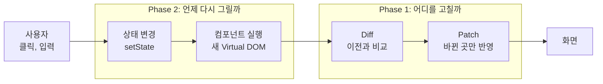
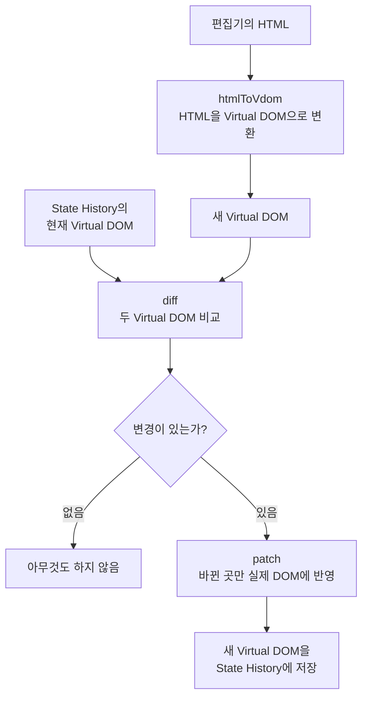
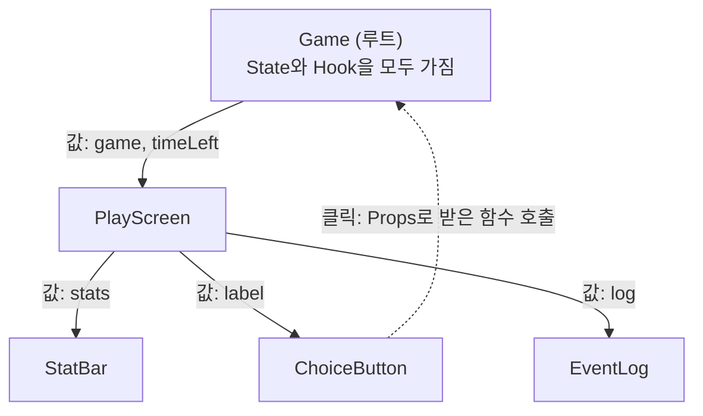
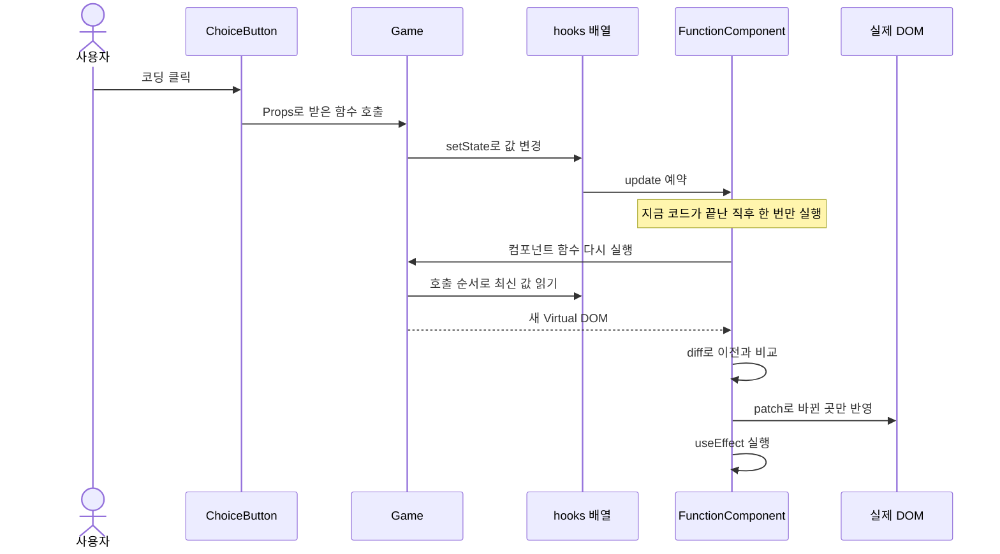

# tiny-react

**React를 쓰지 않고, React가 화면을 바꾸는 원리를 Vanilla JavaScript로 직접 만든 프로젝트이다.**

사용자가 버튼을 누르면 화면 전체를 다시 그리지 않고, 바뀐 부분만 찾아서 고친다. 그 과정을 눈으로 볼 수 있는 게임 `정글 생존기`까지 함께 만들었다.


| 단계 | 푸는 문제 | 만든 것 | 결과물 |
|---|---|---|---|
| Phase 1 | 무엇이 바뀌었는지 어떻게 찾을까? | Virtual DOM, Diff, Patch | 검증 페이지 |
| Phase 2 | 언제, 어떻게 다시 그릴까? | Component, State, Hooks | 게임 `정글 생존기` |

**이 문서의 순서**

1. [왜 만드는가](#1-왜-만드는가)
2. [전체 그림](#2-전체-그림)
3. [Phase 1: 바뀐 곳만 찾아서 고치기](#3-phase-1-바뀐-곳만-찾아서-고치기)
4. [Phase 2: 상태가 바뀌면 자동으로 다시 그리기](#4-phase-2-상태가-바뀌면-자동으로-다시-그리기)
5. [정글 생존기로 확인하기](#5-정글-생존기로-확인하기)
6. [실제 React와의 차이](#6-실제-react와의-차이)
7. [품질 검증](#7-품질-검증)
8. [실행과 구조](#8-실행과-구조)

## 1. 왜 만드는가

브라우저는 HTML을 읽어서 **DOM**이라는 트리를 만든다. 화면에 보이는 글자와 버튼은 모두 이 트리의 노드이다.
JavaScript로 화면을 바꾼다는 것은 이 트리를 고친다는 뜻이다.

그런데 DOM을 고치면 브라우저가 할 일이 생긴다.

- **Reflow:** 요소의 크기와 위치를 다시 계산한다.
- **Repaint:** 바뀐 모습을 화면에 다시 칠한다.

글자 하나가 바뀌었는데 화면 전체를 다시 만들면, 바뀌지 않은 요소까지 새로 만들게 된다.
입력창도 새로 만들어지니 치던 글자의 포커스까지 사라진다.

집을 고칠 때 벽지 한 장 때문에 집을 다시 짓지 않는 것과 같다. **설계도를 비교해서 달라진 곳만 고치면 된다.**
이 프로젝트의 핵심 아이디어가 이것이다.

## 2. 전체 그림

두 Phase는 한 줄로 이어진다. Phase 2가 **언제** 다시 그릴지를 정하고, Phase 1이 **어디를** 고칠지를 정한다.



| 용어 | 쉬운 뜻 |
|---|---|
| Virtual DOM | 화면을 JavaScript 객체로 적어 둔 설계도 |
| Diff | 이전 설계도와 새 설계도를 비교해 달라진 곳을 찾는 일 |
| Patch | 달라진 곳만 실제 화면에 고치는 일 |
| Component | 화면 조각을 만드는 함수 |
| State | 값이 바뀌면 화면도 바뀌어야 하는 데이터 |
| Hook | 함수 안에서 State를 쓰게 해 주는 함수. `useState`, `useEffect`, `useMemo` |

## 3. Phase 1: 바뀐 곳만 찾아서 고치기

Phase 1은 화면을 설계도로 바꾸고, 두 설계도를 비교해서, 바뀐 곳만 고치는 엔진이다.


오른쪽 편집기에서 HTML을 고치고 Patch를 누르면, 왼쪽 실제 영역에서 바뀐 곳만 고쳐진다.
위 화면은 `사과`를 `포도`로, 제목을 `오늘의 장보기`로 고친 결과이다. Patch 기록에 변경 두 건만 남았다.

### 3.1 설계도: Virtual DOM

HTML 한 조각은 이런 객체가 된다. 요소는 `{ type, props, children }`이고, 글자는 문자열이다.

```html
<ul id="list">
  <li>사과</li>
</ul>
```

```js
{
  type: 'ul',
  props: { id: 'list' },
  children: [
    { type: 'li', props: {}, children: ['사과'] },
  ],
}
```

### 3.2 Patch 버튼을 누르면



`diff`는 실제 DOM을 건드리지 않고 변경 목록만 돌려준다. 실제 DOM은 `patch`만 고친다.
그래서 목록에 없는 노드는 같은 DOM 객체로 그대로 남는다.

### 3.3 Diff가 찾는 다섯 가지 변경

| 종류 | 예시 | 실제 DOM 작업 |
|---|---|---|
| `ADD` | 목록에 `<li>`가 하나 늘었다 | `appendChild` |
| `REMOVE` | 목록의 `<li>`가 하나 줄었다 | `remove` |
| `TEXT` | `사과`가 `포도`로 바뀌었다 | `nodeValue` 변경 |
| `REPLACE` | `<p>`가 `<h3>`로 바뀌었다 | `replaceWith` |
| `PROPS` | `class`가 바뀌었다 | `setProp`, `removeProp` |

비교는 위에서 아래로 내려가며 같은 번호의 자식끼리 한다.
태그가 같으면 속성과 자식을 계속 비교하고, 태그가 다르면 그 노드를 통째로 교체한다.

### 3.4 뒤로가기와 앞으로가기

State History는 Virtual DOM 목록과, 지금 위치를 가리키는 포인터이다.
뒤로가기를 누르면 포인터를 옮기고, 지금 화면과 목표 Virtual DOM을 `diff`해서 이번에도 바뀐 곳만 고친다.

## 4. Phase 2: 상태가 바뀌면 자동으로 다시 그리기

Phase 1은 사람이 Patch 버튼을 눌렀다. Phase 2는 상태가 바뀌면 이 과정이 자동으로 일어난다.
이때 과제의 핵심 질문이 나온다.

> 함수는 매번 새로 실행되는데, 상태는 어떻게 유지할까?

### 4.1 상태는 함수 밖에 있다

```js
function Counter() {
  let count = 0;          // 실행될 때마다 다시 0이 된다
  return h('button', { onClick: () => { count += 1; } }, count);
}
```

컴포넌트는 함수이므로, 다시 실행하면 지역 변수는 처음 값으로 돌아간다.
그래서 값을 함수 밖에 둔다. `FunctionComponent` 인스턴스가 가진 `hooks` 배열이 그 자리이다.

Hook은 변수 이름을 받지 않는다. 그래서 **호출 순서로 자기 칸을 찾는다.**

```text
FunctionComponent 인스턴스 (함수가 끝나도 남아 있다)

hooks     [ 0: "정글러" ]  [ 1: 게임 진행 ]  [ 2: 남은 시간 17 ]  ...
               ▲                ▲                  ▲
Game() 실행    │                │                  │
           첫 번째           두 번째            세 번째
           useState          useState           useState
```

렌더를 시작할 때 번호를 0으로 되돌리고, Hook이 호출될 때마다 1씩 올린다.
호출 순서가 바뀌면 칸이 어긋나므로 Hook은 조건문 안에서 쓰지 않는다.

### 4.2 상태는 루트에만 있다

과제의 제약은 "Hook과 State는 루트 컴포넌트에서만 쓴다"이다.
목록 항목처럼 개수가 바뀌는 자식이 Hook을 쓰면 호출 수가 바뀌어 칸이 어긋나기 때문이다.

그래서 자식은 Props만 받아서 그리는 순수 함수이다. 이 구조를 **Lifting State Up**이라고 한다.



값은 Props로 내려가고, 사건은 함수 호출로 올라간다.

### 4.3 버튼 하나를 누르면 일어나는 일



`update()`의 흐름은 Phase 1의 Patch 버튼과 같다. Phase 1의 `diff`와 `patch`를 그대로 쓴다.

```js
update() {
  const next = this.render();             // 컴포넌트 실행, 새 Virtual DOM
  const changes = diff(this.vdom, next);  // 이전과 비교
  patch(this.container, changes);         // 바뀐 곳만 반영
  this.vdom = next;                       // 지금 화면을 기억
  this.runEffects();                      // useEffect 실행
}
```

위 코드는 흐름을 보여 주려고 줄인 것이다. 실제 코드는 [src/core/FunctionComponent.js](src/core/FunctionComponent.js)에 있다.

### 4.4 세 가지 Hook

| Hook | 하는 일 | 칸에 저장하는 것 | 실행 시점 | 게임에서의 쓰임 |
|---|---|---|---|---|
| `useState` | 값을 기억하고 바꾸면 다시 그린다 | 값 | 렌더 중 | 이름, 게임 진행, 남은 시간 |
| `useEffect` | 화면 밖의 일을 한다 | deps, cleanup | `patch` 뒤 | 타이머, 기록 저장, 입력창 포커스 |
| `useMemo` | 계산 결과를 재사용한다 | deps, 계산 결과 | 렌더 중 | 칭호, 글자별 판정 |

**deps**는 "이 값이 바뀌었을 때만 다시 해라"라는 목록이다. 다시 렌더했는지가 아니라 값이 달라졌는지를 본다.

`useEffect`가 `patch` 뒤에 실행되는 이유는, 그때 화면이 준비되어 있어서이다. `useMemo`는 결과가 이번 Virtual DOM에 들어가므로 렌더 중에 계산해야 한다.

### 4.5 여러 상태를 한 번에: Batching

한 번의 클릭에서 상태를 세 번 바꿔도 다시 그리는 일은 한 번이면 충분하다.
`setState`는 값을 바로 바꾸고, `update()`는 `queueMicrotask`로 **한 번만 예약**한다.

```text
setState ─ 값 변경 ─ update 예약
setState ─ 값 변경 ─ 이미 예약됨, 넘어감
setState ─ 값 변경 ─ 이미 예약됨, 넘어감
                     ↓ 지금 코드가 끝난 직후
                  update 한 번
```

## 5. 정글 생존기로 확인하기

Phase 2의 테스트 페이지는 크래프톤 정글에서 5일을 버티고 프로젝트 발표까지 가는 게임이다.

**규칙**

1. 이름을 입력하고 시작한다.
2. 하루 세 번, 20초 안에 `코딩`, `담배 타임`, `코치님 몰래 나가기`, `집 가기` 중에서 고른다. 시간이 지나면 `멍때리기`로 턴이 지나간다.
3. 체력, 실력, 멘탈, 코치 의심도가 바뀌고, 코치 순찰과 회식 같은 사건이 터진다.
4. 5일째 밤에는 발표가 열린다. 20초 안에 함수 이름 다섯 개를 하나씩 입력한다.
5. `발표 대성공`, `발표 폭망`, `번아웃`, `코치 면담`, `그냥 집에 감` 중 하나로 끝난다.


**관찰 패널**은 이 프로젝트의 차별점이다. 오른쪽 패널을 열면 엔진 내부가 그대로 보인다.

| 패널 항목 | 보여 주는 것 |
|---|---|
| 렌더 횟수 | 컴포넌트가 몇 번 다시 실행됐는지 |
| `hooks` 칸 | 함수 밖에 저장된 상태의 현재 값 |
| 변경 기록 | 이번 렌더에서 실제로 바뀐 내용 |

**시연 순서**

1. 게임을 시작하고 패널을 연다. `hooks`의 0번 칸에 입력한 이름이 있다. "상태는 함수 밖에 있다"를 보여 준다.
2. 아무것도 누르지 않고 기다린다. 1초마다 `텍스트 "남은 시간 18초"로 변경` 한 줄만 쌓인다. 화면 전체가 아니라 숫자 하나만 바뀐다.
3. `코딩`을 누른다. 스탯 숫자와 기록 한 줄만 바뀌는 것을 보여 준다. 사건 기록은 `<li> 추가`로 나온다.
4. 발표까지 가서 함수 이름을 입력한다. 글자를 칠 때마다 렌더되지만, 입력창의 포커스는 유지된다.

렌더마다 새로 만들어지는 핸들러도 교체되지만, 화면과 상관없으므로 패널에서는 뺀다.

## 6. 실제 React와의 차이

| 주제 | tiny-react | 실제 React |
|---|---|---|
| 상태 위치 | 루트의 `hooks` 배열 하나 | 컴포넌트마다 Fiber 노드 |
| 자식 컴포넌트 | 바로 실행되어 태그만 남음 | 컴포넌트 경계를 유지 |
| 렌더링 | 한 번에 끝남 | 나누어 실행하고 우선순위 조절 |
| 목록 비교 | 위치로만 비교 | `key`로 항목 구분 |
| `useEffect` | `patch` 뒤에 바로 실행 | 보통 화면을 그린 뒤 실행 |
| 이벤트 | `element.onclick` 프로퍼티 | 루트에서 이벤트 위임 |

전체 차이는 [요구사항 문서](docs/requirements.md#6-미니-리액트와-실제-react의-차이)에 있다.

## 7. 품질 검증

| 종류 | 도구 | 규모 |
|---|---|---|
| 단위 테스트 | Vitest, jsdom | 723개 |
| 기능 테스트 | Playwright, Chrome | 52개 |

구현과 검증을 나누어 진행했다. 구현 담당이 끝낸 단위를, 구현 과정을 모르는 검증 담당이 요구사항만 보고 확인했다.
코드를 일부러 망가뜨려 테스트가 잡는지 보는 고의 결함 검사도 핵심 로직에 썼다.

이 과정에서 찾아 고친 문제의 예시이다.

| 문제 | 해결 |
|---|---|
| 렌더 중에 다시 렌더를 부르면 검사가 우회된다 | 렌더 중의 `mount()`, `update()`는 오류로 막음 |
| 실패한 뒤 같은 값으로 다시 시도하면 무시된다 | 실패를 기록해서 같은 값도 다시 렌더 |
| 지운 `value` 속성이 체크박스에서 되살아난다 | 프로퍼티를 되돌린 뒤 속성을 지움 |
| 코치 면담 엔딩에 도달할 수 없다 | 의심도 100을 순찰 전에 판정 |

## 8. 실행과 구조

### 실행

Node.js 22에서 확인했다. 기능 테스트는 설치된 Chrome을 쓴다.

```bash
npm install
```

```bash
npm run dev
```

개발 서버가 뜨면 `http://localhost:5173`을 연다. Phase 1 페이지가 나오고, 맨 위의 링크로 Phase 2 페이지로 이동한다.

```bash
npm test
```

```bash
npm run test:e2e
```

### 구조

```text
index.html                 Phase 1 검증 페이지
phase2.html                Phase 2 게임 페이지
src/
├── nav.css                두 페이지의 이동 링크
├── core/                  페이지를 모르는 엔진 코드
│   ├── domToVdom.js       DOM → Virtual DOM
│   ├── createDom.js       Virtual DOM → DOM, 속성 넣고 지우기
│   ├── html.js            Virtual DOM ↔ HTML 문자열
│   ├── diff.js            두 Virtual DOM 비교
│   ├── patch.js           변경 목록을 실제 DOM에 적용
│   ├── describeChanges.js 변경 목록을 한 줄 설명으로 변환
│   ├── h.js               Virtual DOM 생성, 자식과 속성 정리
│   ├── hooks.js           useState, useEffect, useMemo
│   └── FunctionComponent.js  hooks 배열, mount(), update()
├── phase1/                Phase 1 페이지 전용 코드
│   ├── StateHistory.js
│   ├── formatHtml.js      textarea에 넣을 HTML 정렬
│   ├── main.js
│   └── style.css
└── phase2/                Phase 2 페이지 전용 코드
    ├── gameData.js        선택지, 함수 이름 같은 상수
    ├── gameLogic.js       게임 규칙을 담은 순수 함수
    ├── components.js      Props만 받는 자식 컴포넌트
    ├── Game.js            루트 컴포넌트. Hook은 여기에서만 쓴다
    ├── inspector.js       관찰 패널
    ├── main.js
    └── style.css
tests/
├── core/, phase1/, phase2/  단위 테스트
└── e2e/                   기능 테스트
```

### 문서

- [요구사항](docs/requirements.md)
- [Phase 1 설계](docs/architecture-phase1.md): Virtual DOM, Diff, Patch의 설계와 `범위 밖` 항목
- [Phase 2 설계](docs/architecture-phase2.md): Component, State, Hooks, 게임의 설계와 `Phase 2 범위 밖` 항목
- [디자인](DESIGN.md): 페이지가 따르는 시각 언어
- [API](docs/api.md): JSDoc에서 자동 생성한다. 다시 만들려면 `npm run docs`를 실행한다.

### 알려진 한계

- `key`로 목록을 비교하지 않으므로, 목록 앞쪽에 항목을 넣으면 뒤따르는 항목이 모두 변경으로 잡힌다.
- 입력 HTML은 사용자가 직접 쓰는 샘플로 보고 보안 필터링을 하지 않는다. `<script>`도 그대로 실행되므로 믿을 수 없는 HTML을 넣으면 안 된다.
- Hook과 State는 과제 제약대로 루트 컴포넌트에서만 쓸 수 있다.
- `onChange`는 브라우저의 `change` 이벤트이므로 입력마다 받으려면 `onInput`을 쓴다.

나머지 한계는 [Phase 1의 `범위 밖`](docs/architecture-phase1.md#범위-밖)과 [`Phase 2 범위 밖`](docs/architecture-phase2.md#phase-2-범위-밖)에 있다.
