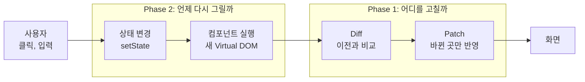
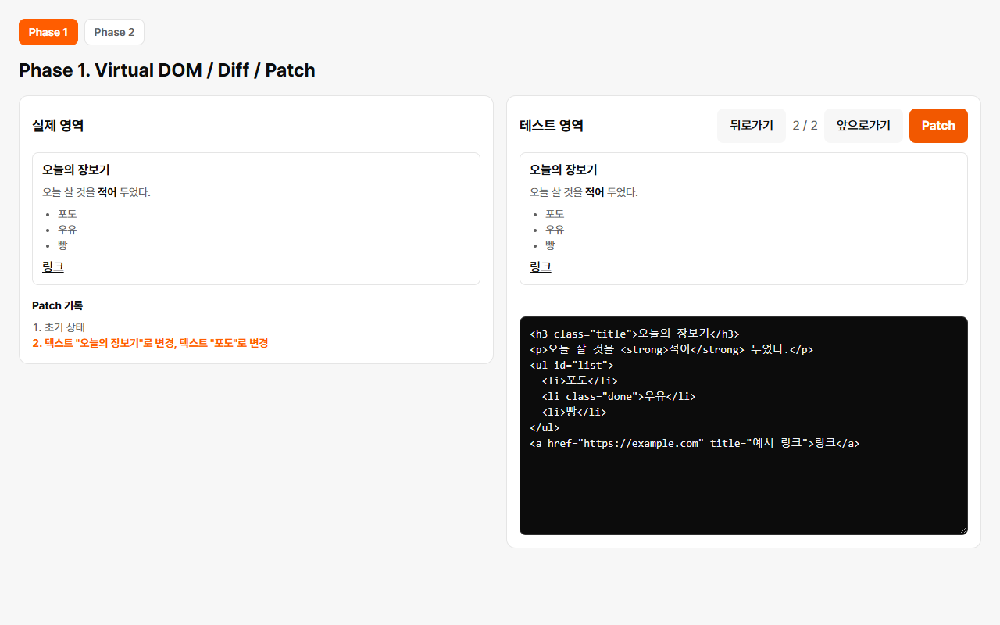
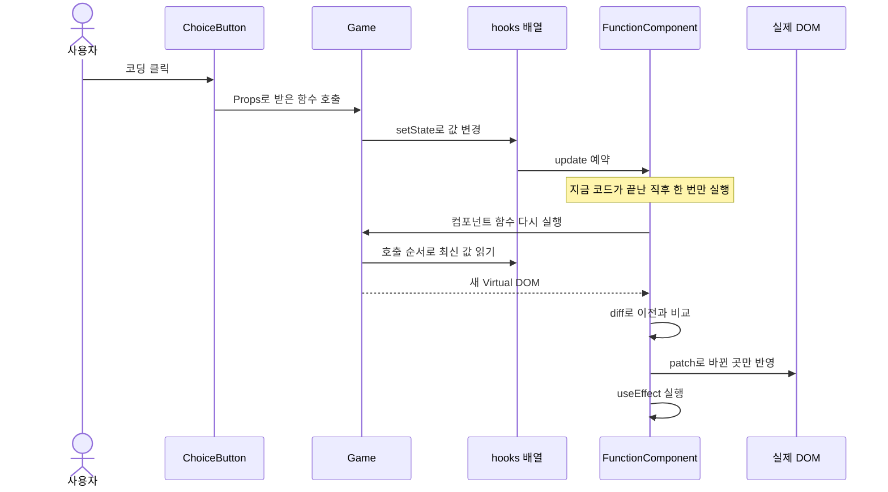
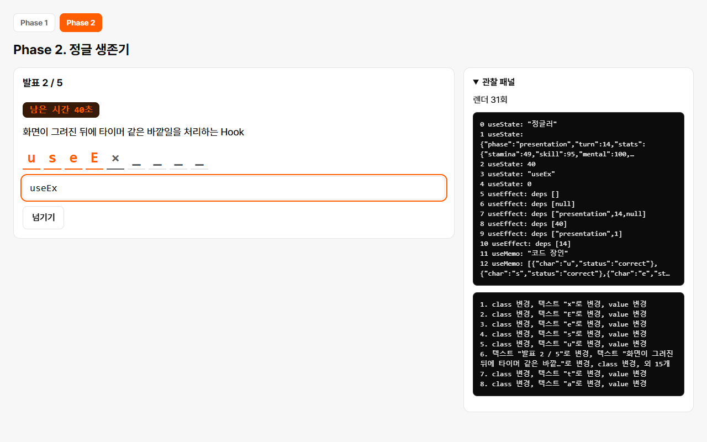

# tiny-react

**React 없이, React가 화면을 바꾸는 원리를 Vanilla JavaScript로 직접 만들었다.**

버튼을 누르면 화면 전체를 다시 그리지 않고 바뀐 곳만 고친다. 그 과정을 눈으로 보는 게임 `정글 생존기`까지 함께 만들었다.


## 1. 전체 그림

화면 전체를 다시 만들면 바뀌지 않은 요소까지 새로 만들어서, Reflow와 Repaint가 늘고 입력 포커스도 사라진다.
그래서 화면의 설계도(Virtual DOM)를 비교해서 달라진 곳만 고친다.



## 2. Phase 1: 바뀐 곳만 찾아서 고치기

HTML을 `{ type, props, children }` 객체로 바꾸고, 이전 객체와 비교해서 변경 목록을 만든다. 실제 DOM은 `patch`만 고친다.



`사과`를 `포도`로, 제목을 `오늘의 장보기`로 고치고 Patch를 누른 결과이다. 변경 두 건만 실제 영역에 반영됐다.

| 변경 | 예시 | 실제 DOM 작업 |
|---|---|---|
| `ADD` | `<li>`가 늘었다 | `appendChild` |
| `REMOVE` | `<li>`가 줄었다 | `remove` |
| `TEXT` | `사과`가 `포도`로 바뀌었다 | `nodeValue` 변경 |
| `REPLACE` | `<p>`가 `<h3>`로 바뀌었다 | `replaceWith` |
| `PROPS` | `class`가 바뀌었다 | `setProp`, `removeProp` |

## 3. Phase 2: 상태가 바뀌면 자동으로 다시 그리기

> 함수는 매번 새로 실행되는데, 상태는 어떻게 유지할까?

답은 **상태를 함수 밖에 두고, 호출 순서로 찾는 것**이다.

```text
FunctionComponent 인스턴스 (함수가 끝나도 남아 있다)

hooks     [ 0: "정글러" ]  [ 1: 게임 진행 ]  [ 2: 남은 시간 17 ]  ...
               ▲                ▲                  ▲
Game() 실행    │                │                  │
           첫 번째           두 번째            세 번째
           useState          useState           useState
```

렌더를 시작할 때 번호를 0으로 되돌리고, Hook이 호출될 때마다 1씩 올린다.
호출 순서가 바뀌면 칸이 어긋나므로 Hook은 루트 컴포넌트에서만 쓴다. 자식은 Props만 받는 순수 함수이고, 상태는 Props로 받은 함수를 호출해서 바꾼다.

**버튼 하나를 누르면 일어나는 일**



| Hook | 칸에 저장하는 것 | 실행 시점 | 게임에서의 쓰임 |
|---|---|---|---|
| `useState` | 값 | 렌더 중 | 이름, 게임 진행, 남은 시간 |
| `useEffect` | deps, cleanup | `patch` 뒤 | 타이머, 기록 저장, 입력창 포커스 |
| `useMemo` | deps, 계산 결과 | 렌더 중 | 칭호, 글자별 판정 |

한 번의 클릭에서 `setState`를 여러 번 불러도 `update()`는 `queueMicrotask`로 한 번만 예약한다(Batching).

## 4. 시연: 정글 생존기

정글에서 5일을 버티고 프로젝트 발표까지 가는 게임이다.
하루 세 번, 20초 안에 `코딩`, `담배 타임`, `코치님 몰래 나가기`, `집 가기` 중에서 고른다.
5일째 밤의 발표에서는 코치의 질문처럼 개념 설명이 나오고, 40초 안에 맞는 함수 이름을 입력한다.



**관찰 패널**이 차별점이다. 엔진 내부를 그대로 보여 준다.

1. 패널을 연다. `hooks` 0번 칸에 입력한 이름이 있다. 상태가 함수 밖에 있다는 증거이다.
2. 기다린다. 1초마다 `텍스트 "남은 시간 18초"로 변경` 한 줄만 쌓인다. 화면 전체가 아니라 숫자 하나만 바뀐다.
3. `코딩`을 누른다. 스탯 숫자와 사건 기록만 바뀐다.
4. 발표에서 함수 이름을 입력한다. 글자마다 렌더되지만 입력 포커스는 유지된다.

## 5. 결과

- **테스트:** 단위 테스트 730개, Chrome 기능 테스트 53개가 통과한다.
- **검증:** 구현 담당과, 구현 과정을 모르는 검증 담당을 나누어 진행했다. 렌더 재진입, 실패 뒤 재시도가 무시되는 문제 같은 버그를 이 과정에서 찾았다.
- **AI 활용:** Phase 1의 사용량을 측정해 설정을 고쳤다. 쉬운 단위는 낮은 모델로 돌리고 전체 최종 리뷰만 가장 강한 모델로 두어, 구현과 검증 1회의 평균 비용을 약 60% 줄였다.

<details>
<summary>실제 React와의 차이</summary>

| 주제 | tiny-react | 실제 React |
|---|---|---|
| 상태 위치 | 루트의 `hooks` 배열 하나 | 컴포넌트마다 Fiber 노드 |
| 자식 컴포넌트 | 바로 실행되어 태그만 남음 | 컴포넌트 경계를 유지 |
| 렌더링 | 한 번에 끝남 | 나누어 실행하고 우선순위 조절 |
| 목록 비교 | 위치로만 비교 | `key`로 항목 구분 |
| `useEffect` | `patch` 뒤에 바로 실행 | 보통 화면을 그린 뒤 실행 |
| 이벤트 | `element.onclick` 프로퍼티 | 루트에서 이벤트 위임 |

전체 차이는 [요구사항 문서](docs/requirements.md#6-미니-리액트와-실제-react의-차이)에 있다.

</details>

<details>
<summary>실행 방법</summary>

Node.js 22에서 확인했다. 기능 테스트는 설치된 Chrome을 쓴다.

```bash
npm install
```

```bash
npm run dev
```

개발 서버가 뜨면 `http://localhost:5173`을 연다. 맨 위의 링크로 Phase 1과 Phase 2 페이지를 오간다.

```bash
npm test
```

```bash
npm run test:e2e
```

</details>

<details>
<summary>파일 구조</summary>

```text
index.html                 Phase 1 검증 페이지
phase2.html                Phase 2 게임 페이지
src/
├── nav.css                두 페이지의 이동 링크
├── core/                  페이지를 모르는 엔진 코드
│   ├── domToVdom.js       DOM → Virtual DOM
│   ├── createDom.js       Virtual DOM → DOM, 속성 넣고 지우기
│   ├── html.js            Virtual DOM ↔ HTML 문자열
│   ├── diff.js            두 Virtual DOM 비교
│   ├── patch.js           변경 목록을 실제 DOM에 적용
│   ├── describeChanges.js 변경 목록을 한 줄 설명으로 변환
│   ├── h.js               Virtual DOM 생성, 자식과 속성 정리
│   ├── hooks.js           useState, useEffect, useMemo
│   └── FunctionComponent.js  hooks 배열, mount(), update()
├── phase1/                Phase 1 페이지 전용 코드
│   ├── StateHistory.js
│   ├── formatHtml.js      textarea에 넣을 HTML 정렬
│   ├── main.js
│   └── style.css
└── phase2/                Phase 2 페이지 전용 코드
    ├── gameData.js        선택지, 발표 문제 같은 상수
    ├── gameLogic.js       게임 규칙을 담은 순수 함수
    ├── components.js      Props만 받는 자식 컴포넌트
    ├── Game.js            루트 컴포넌트. Hook은 여기에서만 쓴다
    ├── inspector.js       관찰 패널
    ├── main.js
    └── style.css
tests/
├── core/, phase1/, phase2/  단위 테스트
└── e2e/                   기능 테스트
```

</details>

<details>
<summary>문서와 알려진 한계</summary>

- [요구사항](docs/requirements.md)
- [Phase 1 설계](docs/architecture-phase1.md)
- [Phase 2 설계](docs/architecture-phase2.md)
- [디자인](DESIGN.md)
- [API](docs/api.md): JSDoc에서 자동 생성한다. 다시 만들려면 `npm run docs`를 실행한다.

`key`로 목록을 비교하지 않으므로, 목록 앞쪽에 항목을 넣으면 뒤따르는 항목이 모두 변경으로 잡힌다.
Phase 1의 입력 HTML은 보안 필터링을 하지 않는다. `<script>`도 그대로 실행되므로 믿을 수 없는 HTML을 넣으면 안 된다.
`onChange`는 브라우저의 `change` 이벤트이므로 입력마다 받으려면 `onInput`을 쓴다.

나머지 한계는 [Phase 1의 `범위 밖`](docs/architecture-phase1.md#범위-밖)과 [`Phase 2 범위 밖`](docs/architecture-phase2.md#phase-2-범위-밖)에 있다.

</details>
