 # tiny-react

**React 없이, React가 화면을 바꾸는 원리를 Vanilla JavaScript로 직접 구현**

- 발표용 README(게임 시연, 결과, 파일 구조): [docs/presentation.md](docs/presentation.md)

## 1. 미니 React

### 1.1 Phase 1: 바뀐 곳만 찾아서 수정

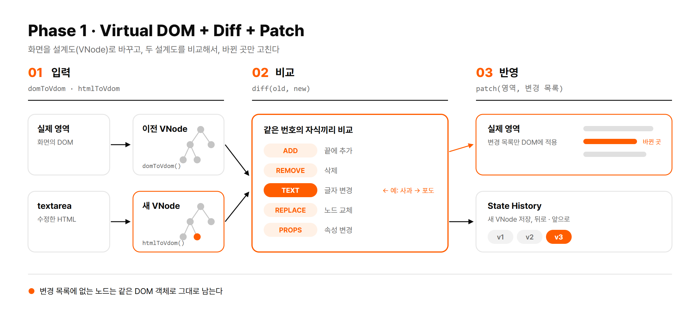

| 순서 | 하는 일 | 위치 |
|---|---|---|
| 1 | 페이지 로드 시 실제 영역을 `domToVdom`으로 이전 VNode 생성 | `src/core/domToVdom.js` |
| 2 | Patch 클릭 시 textarea의 HTML을 `htmlToVdom`으로 새 VNode 생성 | `src/core/html.js` |
| 3 | `diff`로 두 트리 비교 → `patch`로 변경분만 실제 영역에 반영 | `src/core/diff.js`, `src/core/patch.js` |
| 4 | 새 VNode를 State History에 저장, 뒤로와 앞으로도 diff 후 Patch | `src/phase1/StateHistory.js` |

### 1.2 Phase 2: 상태가 바뀌면 자동으로 다시 그리기

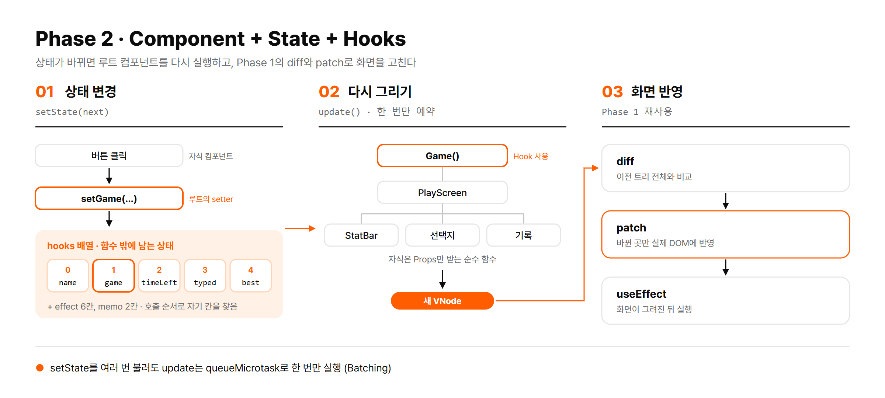

| 순서 | 하는 일 | 위치 |
|---|---|---|
| 1 | `setState`로 루트의 `hooks` 칸 값 변경 | `src/core/hooks.js` |
| 2 | 루트 `Game` 다시 실행, Hook은 호출 순서로 자기 칸 탐색 | `src/phase2/Game.js` |
| 3 | 자식 컴포넌트는 Props만 받아 새 VNode 생성 | `src/phase2/components.js`, `src/core/h.js` |
| 4 | Phase 1의 `diff`로 이전 트리 전체와 비교 | `src/core/diff.js` |
| 5 | Phase 1의 `patch`로 실제 DOM 반영 후 `useEffect` 실행 | `src/core/FunctionComponent.js` |

- 상태 위치: 함수 밖, `FunctionComponent` 인스턴스의 `hooks` 배열 → 함수가 다시 실행돼도 값 유지
- Batching: 한 번의 클릭에서 `setState`를 여러 번 불러도 `update`는 `queueMicrotask`로 한 번만 실행

### 1.3 테스트 페이지: 정글 생존기

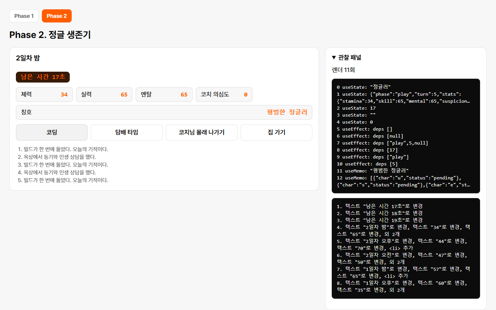

- 오른쪽 관찰 패널: 렌더 횟수, `hooks` 칸의 값, 렌더마다 실제로 바뀐 내용 표시
- 시연과 게임 규칙: [docs/presentation.md](docs/presentation.md)

## 2. 실제 React와의 차이

| 주제 | tiny-react | 실제 React |
|---|---|---|
| **목록 비교** | **위치로만 비교** | **`key`로 항목 구분** |
| **상태 위치** | **루트의 `hooks` 배열 하나** | **컴포넌트마다 Fiber 노드** |
| 자식 컴포넌트 | 바로 실행, 태그만 남음 | 컴포넌트 경계 유지 |
| 렌더링 | 한 번에 완료 | 나누어 실행, 우선순위 조절 |
| `useEffect` | `patch` 직후 실행 | 보통 화면을 그린 뒤 실행 |
| 이벤트 | `element.onclick` 프로퍼티 | 루트에서 이벤트 위임 |
| `onChange` | 브라우저 `change` 이벤트(입력이 끝날 때) | 입력할 때마다 |

- 굵게 표시한 두 가지를 3절에서 자세히 설명

## 3. 세부적인 차이

### 3.1 key 유무

- `key`: 목록 항목을 "몇 번째인가"가 아니라 "누구인가"로 비교하게 하는 이름표
- tiny-react: `key` 없음 → 같은 번호의 자식끼리 비교

**예시: `['사과', '우유', '빵']`에서 `사과` 삭제**

| 번호 | 이전 | 새것 | key 없음 (tiny-react) | key 있음 (React) |
|---|---|---|---|---|
| 0 | 사과 | 우유 | `TEXT` 우유로 변경 | 그대로 (`우유` 노드 유지) |
| 1 | 우유 | 빵 | `TEXT` 빵으로 변경 | 그대로 (`빵` 노드 유지) |
| 2 | 빵 | 없음 | `REMOVE` | `사과` 노드만 `REMOVE` |
| | | | **변경 3건** | **변경 1건** |

- 끝에서 추가, 삭제: 차이 없음
- 앞이나 가운데에서 추가, 삭제: 그 위치부터 끝까지 전부 변경

**코드로 보기**

```js
// tiny-react (src/core/diff.js): 같은 번호끼리 비교
for (let index = 0; index < newChildren.length; index += 1) {
  diffNode(oldChildren[index], newChildren[index], [...path, index], changes);
}
```

```js
// key가 있다면 (React 방식, 구현하지 않음): 같은 key끼리 비교
const oldByKey = new Map(oldChildren.map((child) => [child.props.key, child]));
for (const child of newChildren) {
  diffNode(oldByKey.get(child.props.key), child, ...);
}
```

**트리로 보기: key 없음 → 번호로 짝짓기**

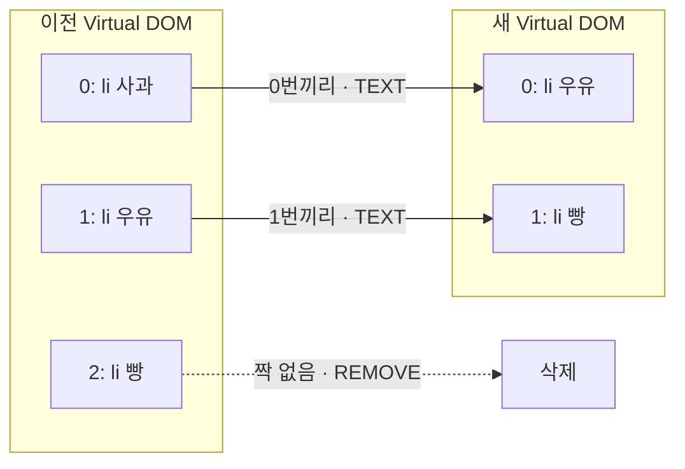

**트리로 보기: key 있음 → 이름표로 짝짓기**

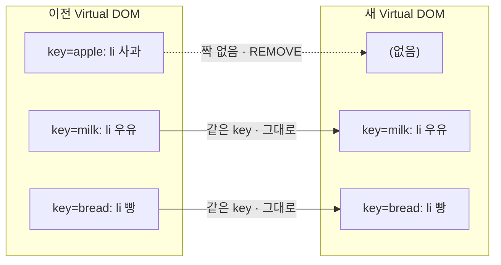

**문제 1: DOM 상태가 엉뚱한 항목으로 넘어감**

- DOM 노드에는 Virtual DOM에 없는 상태가 붙어 있음: 체크 여부, 입력 중인 글자, 포커스, 스크롤 위치
- key 없음 → 노드를 재사용해 글자만 변경 → 상태는 다른 항목에 남음

```text
사과에 체크한 뒤 사과 삭제

이전 DOM          새 화면
[✓] 사과   ──▶   [✓] 우유    ← 같은 노드를 재사용해서 체크가 우유로 넘어감
[ ] 우유   ──▶   [ ] 빵
[ ] 빵     ──▶   (삭제)
```

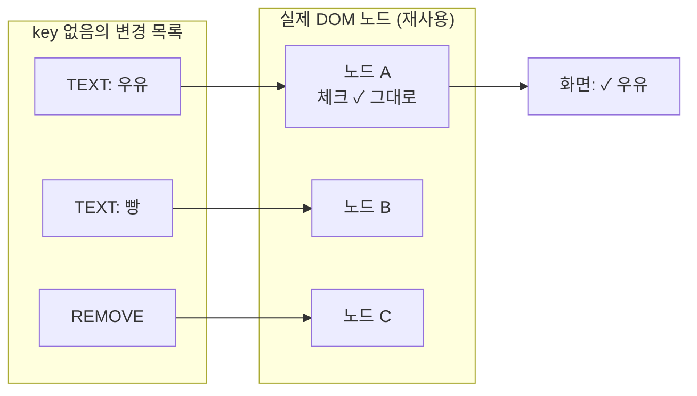

- 실제 발생 사례: 게임에서 밤에 키보드로 `코딩` 선택 → 회식 버튼 등장 → 포커스가 같은 노드인 `회식 참석`에 남음 → Enter 한 번에 회식 참석 (4절에서 회피)

**문제 2: 성능**

- Chrome에서 측정, 항목마다 체크박스, 글자, 버튼이 있는 `<li>` 하나 삭제
- 기준: 한 화면 약 16.7ms(1초에 60번), 넘으면 화면 끊김

| 항목 수 | 삭제 위치 | key 없음 | key 있음 (근사) |
|---|---|---|---|
| 100 | 맨 앞 | 1.1ms | 0.2ms |
| 1,000 | 맨 앞 | 7.9ms | 1.6ms |
| 5,000 | 맨 앞 | **41.8ms** | 5.1ms |
| 5,000 | 맨 끝 | 4.5ms | 6.0ms |

- 1,000개까지는 체감 차이 없음, 5,000개 맨 앞 삭제부터 끊김 가능
- key 쪽은 근사값: tiny-react에 key 비교가 없어 "전체 비교 + 노드 하나 삭제" 시간으로 대신 측정

### 3.2 컴포넌트별 State 없음

- tiny-react: `hooks` 배열이 루트 `FunctionComponent`에 하나뿐, 자식 컴포넌트는 State를 가질 수 없음 (과제 제약)
- 실제 React: 컴포넌트마다 자기 State 보유

**이유: 호출 순서로 칸을 찾는 구조**

- 자식이 Hook을 쓰면 자식의 칸도 같은 배열에 들어감
- 목록 항목처럼 개수가 바뀌는 자식 → Hook 호출 수 변화 → 칸이 어긋남

**코드로 보기** (자식의 Hook을 허용한다고 가정, 실제로는 오류로 차단)

```js
function Item({ label }) {
  const [done, setDone] = useState(false);   // 자식이 Hook 사용
  return h('li', null, done ? '완료' : label);
}

function App() {
  const [items] = useState(['사과', '빵']);    // hooks[0]
  // 사과의 done → hooks[1], 빵의 done → hooks[2]
  return h('ul', null, items.map((label) => h(Item, { label })));
}
```

**트리로 보기: 칸이 어긋나는 과정**

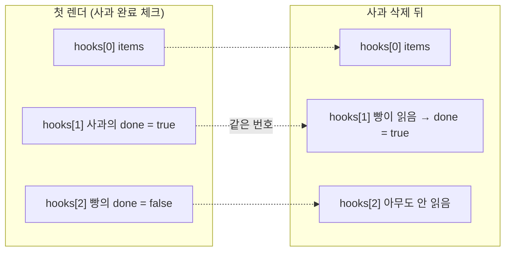

- 빵은 완료한 적이 없는데 완료로 표시
- 상태가 "어떤 항목의 것인지"가 아니라 "몇 번째 칸인지"로만 구분되기 때문

**트리로 보기: 상태가 사는 곳**

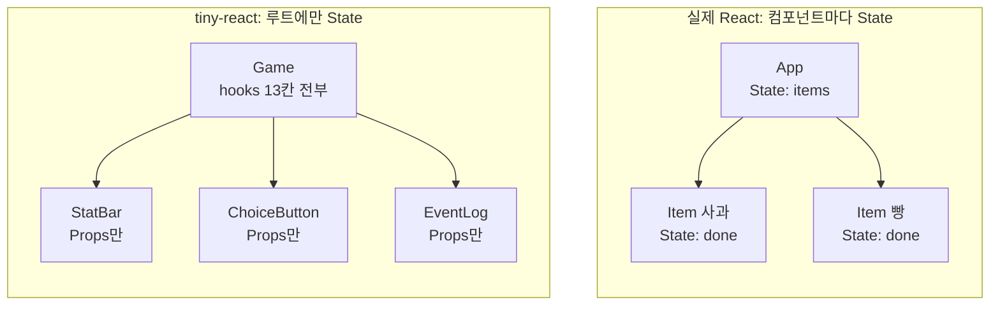

**결과**

| 항목 | tiny-react | 실제 React |
|---|---|---|
| 상태를 두는 곳 | 모든 상태를 루트로 올림 (Lifting State Up) | 쓰는 컴포넌트 가까이 |
| 상태 하나가 바뀌면 다시 실행되는 범위 | 루트 컴포넌트 전체, 화면 전체 Diff | 바뀐 컴포넌트와 그 아래만 |
| 자식에서 Hook 호출 | 오류로 차단 | 허용 |

- 화면이 커질수록 작은 상태 변경에도 전체를 다시 계산
- 예: 게임의 1초 타이머 → 매초 `Game` 전체 실행과 화면 전체 Diff, 실제 변경은 숫자 하나

**트리로 보기: 타이머 1초마다 다시 실행되는 범위** (주황색)

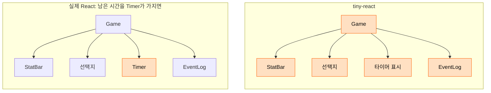

## 4. 차이에 대한 수정 혹은 회피 방안

### 4.1 key 유무

**회피 (현재 적용)**

| 방법 | 적용한 곳 | 효과 |
|---|---|---|
| 1. 목록은 끝에만 추가 | 게임의 사건 기록 | 변경은 끝의 `ADD` 하나 |
| 2. 다른 항목이 같은 자리에 오면 감싸는 태그를 다르게 | 선택지와 회식 버튼 | `REPLACE`로 새 노드, 포커스 넘어감 차단 |
| 3. 입력창은 바뀌는 목록 밖에 배치 | 발표 화면 | 입력창 번호 고정, 포커스 유지 |

**1. 목록은 끝에만 추가**

```js
// src/phase2/components.js: 기록은 항상 끝에 쌓임
h('ol', { class: 'event-log' }, ...log.map((text) => h('li', null, text)))
```

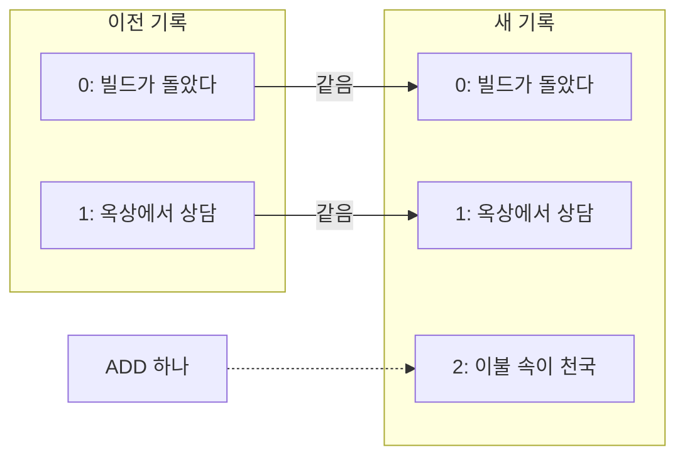

- 앞쪽 번호가 그대로라 비교 결과는 끝의 `ADD` 하나
- 최신 기록을 위로 뒤집으면 모든 줄이 한 칸씩 밀려 전부 `TEXT` 변경 → 대신 자동 스크롤

**2. 감싸는 태그를 다르게**

```js
// src/phase2/components.js: 회식 버튼만 section으로 감쌈
dinner
  ? h('section', { class: 'choices' }, 회식참석버튼, 회식불참버튼)
  : h('div', { class: 'choices' }, 코딩버튼, 담배버튼, 몰래버튼, 집버튼)
```

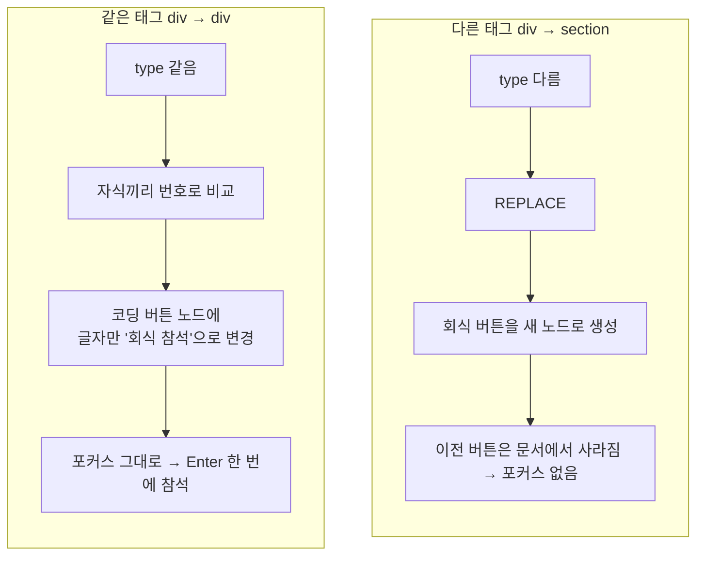

**3. 입력창은 바뀌는 목록 밖에 배치**

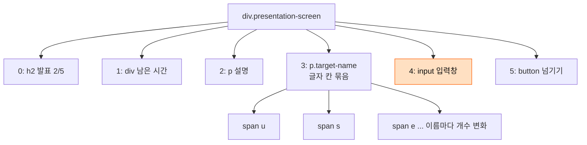

- 글자 칸은 `p.target-name` 안에서만 늘고 줄어듦 → 입력창은 항상 4번 자리
- 글자 칸을 입력창과 같은 줄에 두면 `useState`(8칸)에서 `useEffect`(9칸)로 바뀔 때 입력창 번호가 밀려 다른 노드로 교체

**수정 (구현한다면)**

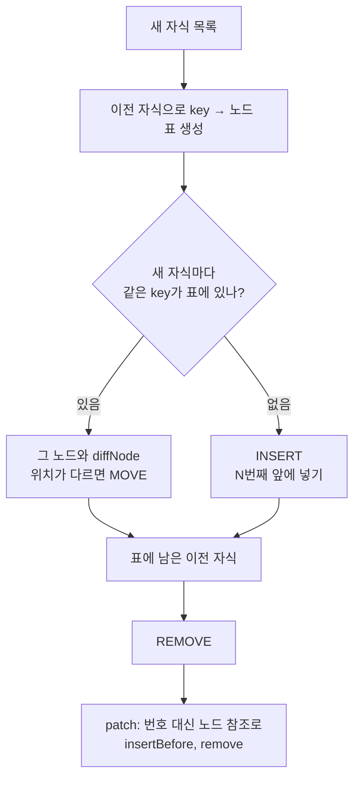

```js
// 지금: 끝에만 붙이는 ADD
parent.appendChild(createDom(change.node));

// 수정: 원하는 자리 앞에 넣는 INSERT, 기존 노드를 옮기는 MOVE
parent.insertBefore(createDom(change.node), parent.childNodes[change.index]);
parent.insertBefore(movedNode, parent.childNodes[change.index]);
```

- 범위: `diff`, `patch`, 변경 형식 모두 수정 → Phase 1 구조 변경

### 4.2 컴포넌트별 State 없음

**회피 (현재 적용)**

| 방법 | 내용 |
|---|---|
| 1. Lifting State Up | 상태는 루트에만, 자식은 Props만 받는 순수 함수 |
| 2. 이벤트는 함수로 전달 | 자식은 Props로 받은 함수 호출로 상태 변경 요청 |
| 3. 무거운 계산 보호 | `useMemo`로 deps가 같으면 재계산 생략 |
| 4. 규칙 위반 차단 | 자식이나 렌더 밖의 Hook, Hook 개수와 순서 변경 → 오류 |

**1, 2. 값은 내려가고 사건은 올라감**

```js
// 루트 Game: 상태와 상태를 바꾸는 함수를 가짐
const choose = (id) => setGame((current) => playTurn(current, id, random));
h(PlayScreen, { game, onChoose: choose });

// 자식: Props만 받아 그리고, 클릭은 받은 함수 호출로 알림
h(ChoiceButton, { label: '코딩', onClick: () => onChoose('coding') });
```

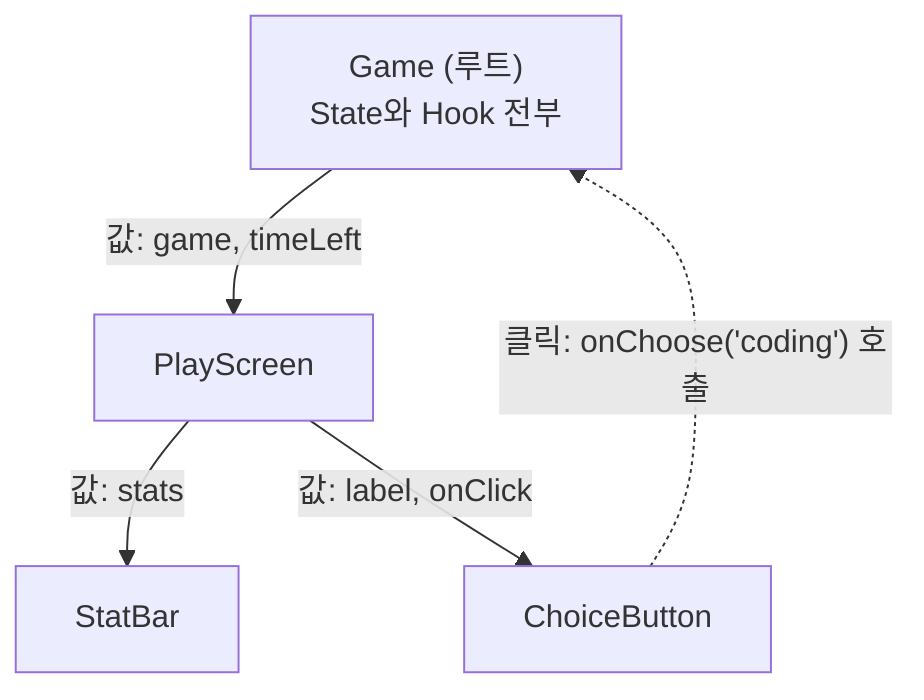

**3. 무거운 계산 보호**

```js
// 타이머 때문에 매초 Game이 다시 실행돼도, stats가 같으면 칭호 계산은 건너뜀
const title = useMemo(() => getTitle(game.stats), [game.stats]);
```

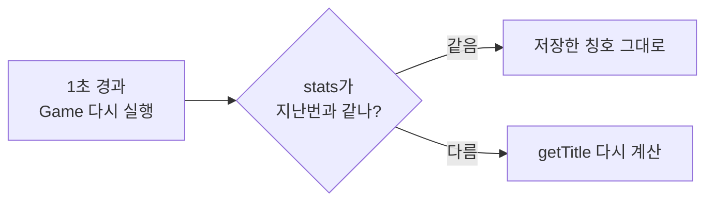

**수정 (구현한다면)**

```js
// 지금 (src/core/h.js): 자식 컴포넌트를 바로 실행해 태그만 남김
if (typeof type === 'function') {
  return withoutHooks(() => type({ ...(props ?? {}), children: normalized }));
}

// 수정: 컴포넌트를 노드로 남기고, 렌더할 때 인스턴스마다 hooks로 실행
if (typeof type === 'function') {
  return { type, props: { ...props, key, children: normalized } };
}
```

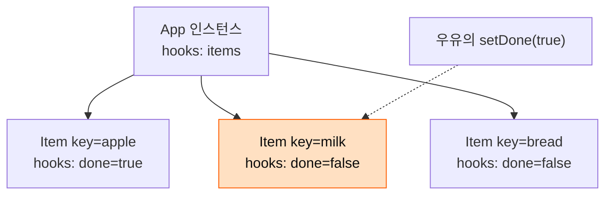

- 인스턴스마다 `hooks` 보유 → 우유의 상태가 바뀌면 우유 `Item`만 다시 실행 (주황색)
- 사과를 지워도 key로 인스턴스를 찾으므로 빵은 자기 `hooks`를 그대로 유지 → 3.2의 칸 어긋남 해결
- key가 있어야 인스턴스를 찾을 수 있음 → 4.1과 함께 필요
- 범위: `h`, `FunctionComponent`, `diff` 모두 수정, 과제 제약("Hook과 State는 루트 컴포넌트에서만") 밖이라 미구현

## 실행

```bash
npm install
```

```bash
npm run dev
```

```bash
npm test
```

```bash
npm run test:e2e
```

- 문서: [요구사항](docs/requirements.md), [Phase 1 설계](docs/architecture-phase1.md), [Phase 2 설계](docs/architecture-phase2.md), [API](docs/api.md)
